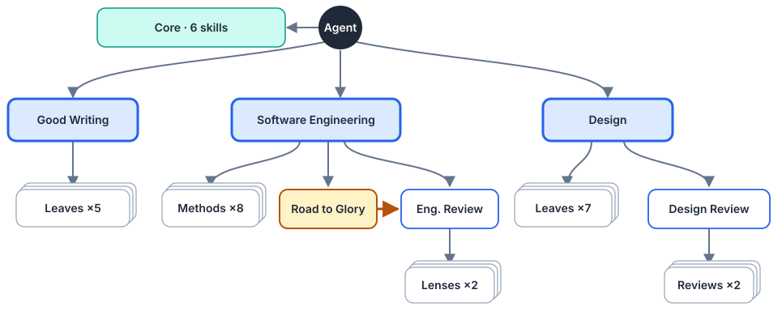

# Skill Profile

A curated collection of agent skills for Claude Code, Codex, Kimi Code and
Gemini CLI, composed as **trees** rather than a flat list. Each skill is a
complete package — instructions, metadata, references, scripts, assets,
licenses and provenance — that works on its own, and the collection defines how
the skills route to each other so an agent loads only what a task needs.

- Find a skill, its type and its provenance in [SKILLS.md](SKILLS.md).
- Read [AGENTS.md](AGENTS.md) before changing anything in this repository.
- The authoring method for new skills, including the full rules summarized
  below, is [Skill Issue](skills/core/skill-issue/SKILL.md) and its
  [architecture reference](skills/core/skill-issue/references/skill-architecture.md).

## The architecture

<picture>
  <source media="(prefers-color-scheme: dark)" srcset="figures/skill-architecture.dark.svg">
  
</picture>

Picture a room. The agent stands in the middle. Around it are **core skills** it
can use anywhere, and **trees**, one per domain. A request enters a tree at its
root, which decides where in the tree the work belongs; the agent then moves
down that tree and nowhere else.

### Why trees

- **Routing saves context.** Only the roots and the core skills compete for
  selection. A coding request loads the Software Engineering root and the
  branch it needs, not every skill whose description mentions code.
- **Flows define order and roles.** Multi-step work — especially with several
  agents — needs one place that says what happens in which order and who does
  it. The orchestrating agent follows the flow; delegates take single branches.
- **Leaves stay reusable.** A method that loads nothing and assumes no caller
  can serve any router, any flow, or a user who calls it by name.

The alternative this replaced was a mesh: in November 2026 the 30 skills formed 39
mutually referencing pairs, the three most important engineering methods were loaded in
none of 20 realistic coding requests in a trigger test, and a small task could
pull in half the collection.

### Six types

| Type | What it is | Selected | Loads | In this profile |
|---|---|---|---|---|
| **Core** | Standalone method on the agent's surface, useful in any context | Implicitly | Nothing | Unslop, MinMax Tokens, Puppeteer, Skill Issue, Workspace Management |
| **Domain** | Root of a tree; establishes the context and routes | Implicitly | Its children | Good Writing, Software Engineering; Design is planned |
| **Parent** | Inner node that applies its children together | Through its parent | Its children | Engineering Review over its lenses |
| **Core flow** | Runs steps left to right, with roles, from the surface | Implicitly | Its step skills, in any tree | None yet |
| **Flow** | Runs steps left to right, with roles, inside a tree | Through its domain | Its step skills, in its tree | Road to Glory |
| **Leaf** | Self-contained method, always invoked manually | Through a routing skill or by a person | Nothing | Golden Comments, Customer Writing, Grilling, Grilling with Agents, … |

Domain, parent, flow and core-flow skills are **routing skills**: nodes that
have children. Every skill has exactly one type, and the type fixes how it is
selected: core, core flow and domain are implicit; parent, flow and leaf are
explicit-only.

**Selection decides the type.** What lies on the agent's surface — what it may
select by itself — is a core skill, a core flow or a domain root. Core flow and flow
share a shape: a core flow stands in the middle and may enter several trees; a
flow lives inside one tree and is reached through its domain. Everything else is
invoked manually: by a routing skill above it, or by a person. There is no
manual core skill. Grilling, the interview you start with "grill me", is a leaf
whose root is you: you call it, it loads nothing, and it works on its own.

A domain routes in one of two ways. Good Writing **selects** the one
specialist that owns the result. Software Engineering selects by **role** —
implementer, orchestrator, reviewer, documenter — and loads that role's
**pack**, the methods that always apply together in that role.

### How an agent moves

1. **Start in the middle.** Only core skills, core flows and domain roots are
   implicit; from the middle the agent may enter one tree or several.
2. **Go down.** A routing skill names its children; a child never names its
   caller and returns its result to whoever loaded it.
3. **Never cross trees.** When work in one tree needs another tree, the need
   goes back to the middle, and the agent opens the second domain itself.
4. **Do not reconnect branches.** When two siblings need the same child, their
   common parent loads it; when every tree needs it, it is core.
5. **Read flows left to right.** A flow orders skills that remain usable
   without it; it adds the order, the hand-offs and conditions such as "only as
   the orchestrating agent".

### Four walks through the profile

**A quick fix.** "Fix the double charge when users click pay twice." The agent
enters Software Engineering, takes the implementer role and reads its pack:
Engineering Practices chooses an idempotency key, Vertical Slices keeps the
guard inside the payment capability, Golden Comments records why the key
exists. No flow, no delegation.

**Substantial work.** "Add cancellation across ordering, inventory and billing."
Software Engineering assigns the orchestrator role, which runs Road to Glory:
plan, delegate, review, document, close. Each delegate receives the implementer
pack by name in its brief through Puppeteer's `Skills:` field. The review step
loads Engineering Review, a parent that applies its lenses; the documentation
step switches the lead to the documenter role.

**Two domains at once.** "Write the release notes and add a diagram of the new
flow." The agent opens Good Writing, which routes to Technical Writing, and the
Design domain for the explanatory figure. Technical Writing does not call the
diagram skill itself: that would be an edge across trees.

**A shared child.** The implementer and the reviewer both need Marshmallow
Tests. Neither role's methods load it; the Software Engineering domain lists it
in both role rows, so the branches never reconnect below the root.

### Declaring types and dependencies

The [Agent Skills specification](https://agentskills.io/specification) has no
field for dependencies between skills; its `metadata` field is a free map of
strings. Each skill therefore declares its place in `metadata`:

```yaml
metadata:
  skill-type: flow
  skill-tree: software-engineering
  skill-requires: engineering-review puppeteer
```

The agent reads the same facts in the first line of the body, after it has
chosen the skill, including what to do when a required child is missing: stop
and report the skill as incomplete rather than run it partially. Descriptions
stay free of both, because they decide selection. Humans see the type in the
catalog: every short description starts with it, as in
`Leaf: Complete replacements and model corrections`.

Dependencies are best checked when installing, not while working: an
installer should refuse a routing skill whose required children are missing
and report edges that point up or across trees. Packaging a whole tree
together, for example as one plugin, is the planned distribution unit.

## Status

The type system and the two existing domains are in place:

- **Software Engineering** is live as a role-based domain. In a windowed trigger
  test with `claude -p`, it loaded on 19 of 20 coding requests and 12 of 16
  unseen ones, with no false positives; Engineering Practices, Golden Comments
  and Vertical Slices are explicit-only and loaded through it. The evidence is in
  [its notice](skills/software-engineering/software-engineering/NOTICE.md).
- **Good Writing** routes to explicit-only writing specialists.
- **Design** is planned: Frontend Design, Editorial SVG Diagrams and Motion
  Design remain implicit until their domain exists.

Not yet applied everywhere: the `metadata` declarations and type prefixes on
every skill, and the removal of the remaining back-references and cross-tree
edges. The [writing map](SKILLS.md#writing-family-map) and the
[engineering matrix](SKILLS.md#engineering-and-general-map) show what is left;
`skills/core/skill-issue/scripts/skill_graph.py` measures it.

## Layout

```text
skills/core/                   Core skills
skills/writing/                Good Writing and its specialists
skills/software-engineering/   Software Engineering, its flow, parent and leaves
skills/design/                 Design leaves (domain planned)
skills/extras/                 Optional skills kept for occasional use
figures/                       Editable SVG maps of the collection, light and dark
archive/                       Complete previous package snapshots (ZIP + manifest)
```

Installation is flat: each client sees `<skill-root>/<skill-name>/SKILL.md`;
the folders above group ownership and routing, not installation paths.

## Using the skills

Copy a complete skill folder — never only `SKILL.md` — into your client's skill
root, for example `~/.claude/skills/` for Claude Code or `~/.codex/skills/` for
Codex. Install a routing skill together with the children it lists in
`skill-requires`. Explicit-only skills declare that in `agents/openai.yaml`
(`policy.allow_implicit_invocation: false`); for Claude Code, set
`disable-model-invocation: true` in the frontmatter of the installed copy.
Tools, MCP servers and accounts a skill mentions are not installed by copying it.

Each skill keeps its licenses and a `NOTICE.md` where it adapts other work;
[SKILLS.md](SKILLS.md) records the provenance of the collection.
