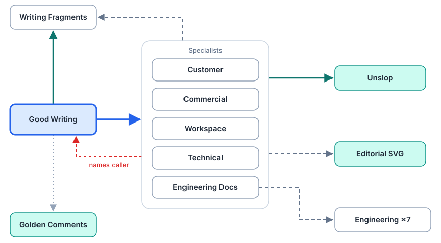
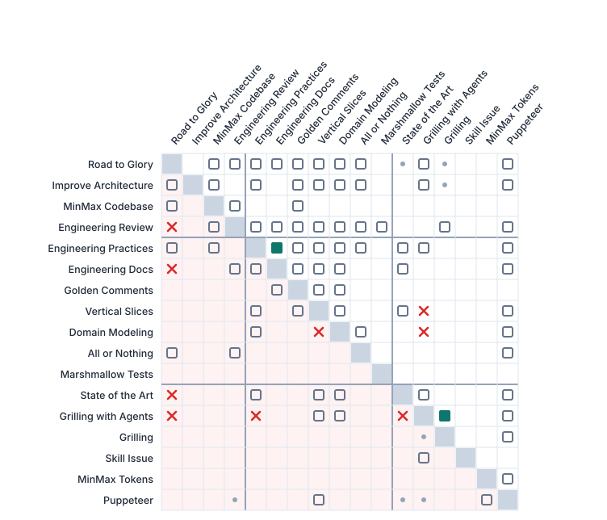

# Skill Inventory

This inventory distinguishes repository-owned sources, reviewed external
snapshots and external catalog entries. A link is evidence of provenance, not a
claim that the latest upstream revision is installed locally.

Skills live in `skills/<group>/<skill>/`. Installation stays flat per client;
the groups mark ownership, routing and future packaging. Each entry starts with
the skill's type — core, core flow, domain, parent, flow or leaf — as defined in
the [README](README.md#six-types) and Skill Issue's
[architecture reference](skills/core/skill-issue/references/skill-architecture.md).

## Core skills

Cross-cutting methods on the agent's surface: delegation, skill authoring,
information economy, prose, explanatory figures and workspace context.
Judgment is a project-owned core method listed under
[project-owned skills](#project-owned-skills).

| Skill | Purpose and provenance |
|---|---|
|  [`editorial-svg-diagrams`](skills/core/editorial-svg-diagrams/SKILL.md) | **Core.** Reviewed adaptation of the user-supplied 2026-10-23 `skill.zip`, with the three accepted test figures. Owns visual-first transparent SVGs, explicit theme variants, exports and visual review. [Provenance and review changes](skills/core/editorial-svg-diagrams/NOTICE.md); [current import hashes](skills/core/editorial-svg-diagrams/source-manifest-20261023.json). Implicit invocation enabled. |
|  [`minmax-tokens`](skills/core/minmax-tokens/SKILL.md) | **Core.** Repository-owned method for reducing unnecessary context and tool output without weakening verification. |
|  [`puppeteer`](skills/core/puppeteer/SKILL.md) | **Core.** Repository-owned delegation method for bounded tasks, shared-resource ownership and verified integration. |
|  [`skill-issue`](skills/core/skill-issue/SKILL.md) | **Core.** Repository-owned skill authoring, evaluation and review method, rebased on 2026-11-10 on Anthropic's Skill Creator: create–test–improve loop, progressive disclosure, triggering and description tuning, `evals/` cases, plus local router and composition rules and a `scripts/skill_graph.py` dependency audit. Earlier Matt Pocock and OpenAI influences remain; [sources and adaptation](skills/core/skill-issue/NOTICE.md) record the snapshots. All three source licenses are preserved. |
|  [`unslop`](skills/core/unslop/SKILL.md) | **Core.** Maintained adaptation of Pstack Unslop, Humanizer and Writing Clearly and Concisely. [Provenance](skills/core/unslop/NOTICE.md), pinned hashes and all three MIT licenses are preserved. Shared language rules for German and English; implicit invocation enabled. |
|  [`workspace-management`](skills/core/workspace-management/SKILL.md) | **Core.** Repository-owned workflow for provider-neutral, host-local Workspace context and AI-project bindings. |

## Writing

Good Writing is the implicit router; the specialists are explicit-only and
loaded by it. See the [writing family map](#writing-family-map).

| Skill | Purpose and provenance |
|---|---|
|  [`commercial-writing`](skills/writing/commercial-writing/SKILL.md) | **Leaf.** Adapted from the same export. Evidence-grounded offers, sales arguments and commercial decisions. |
|  [`customer-writing`](skills/writing/customer-writing/SKILL.md) | **Leaf.** Repository-owned method for external correspondence with customers and business partners. |
|  [`good-writing`](skills/writing/good-writing/SKILL.md) | **Domain.** Adapted from the user-supplied 2026-09-23 export. Short common entry selecting the relevant writing specialist. |
|  [`technical-writing`](skills/writing/technical-writing/SKILL.md) | **Leaf.** Standalone technical manuals, procedures and reference from verified specifications and source material, without assuming a codebase. [Scope and lineage](skills/writing/technical-writing/NOTICE.md). |
|  [`workspace-writing`](skills/writing/workspace-writing/SKILL.md) | **Leaf.** Repository-owned method for shared working knowledge in OpenAI ChatGPT Pages and Spaces, organized by related topics and maintained in place. |
|  [`writing-fragments`](skills/writing/writing-fragments/SKILL.md) | **Leaf.** Locally rewritten source scouting and selection method before writing: keeps evidence, context, uncertainty and figure candidates in a compact handoff. Originated in the same export adapting [Matt Pocock's Writing Fragments](https://github.com/mattpocock/skills/blob/main/skills/in-progress/writing-fragments/SKILL.md); its MIT license and attribution are preserved. Native implicit invocation remains disabled; Good Writing loads the method deliberately. |

## Software Engineering

These skills are maintained as part of this repository. Their primary source is
Tobi's former global Engineering instructions and the revision decisions in the
joined `engineering-skills` Git history. Individual `NOTICE.md` files preserve
supplementary Matt Pocock attribution where applicable. Software Engineering is
the group's context router: Engineering Practices, Golden Comments and Vertical
Slices are loaded only through it, while the other methods keep their own
triggers for now. See the [engineering map](#engineering-and-general-map).

| Skill | Purpose and provenance |
|---|---|
|  [`all-or-nothing`](skills/software-engineering/all-or-nothing/SKILL.md) | **Leaf.** Complete an agreed replacement and retire the superseded owner. |
|  [`domain-modeling`](skills/software-engineering/domain-modeling/SKILL.md) | **Leaf.** Locally maintained domain-language and naming method, adapted from Matt Pocock; keeps existing canonical owners and conditional structural handoffs. [Provenance](skills/software-engineering/domain-modeling/NOTICE.md). |
|  [`engineering-documentation`](skills/software-engineering/engineering-documentation/SKILL.md) | **Leaf.** Maintain README, repository agent instructions and code-owned docs as distinct entrypoints to one system. Uses primary visual explanations and Synopsis's ordered chapters; [lineage and evidence](skills/software-engineering/engineering-documentation/NOTICE.md). |
|  [`engineering-practices`](skills/software-engineering/engineering-practices/SKILL.md) | **Leaf.** Repository-owned decision criteria for architecture, configuration ownership, data, security, recovery, toolchains and delivery. Scaled to the actual project and change. [Source influences](skills/software-engineering/engineering-practices/NOTICE.md); current research belongs to State of the Art. |
|  [`engineering-review`](skills/software-engineering/engineering-review/SKILL.md) | **Parent.** Independent review of implementation, rendered UI and documentation, with traceable questions and corrections. [Source influences](skills/software-engineering/engineering-review/NOTICE.md). |
|  [`golden-comments`](skills/software-engineering/golden-comments/SKILL.md) | **Leaf.** Preserve design intent, system context and decision reasons beside source during ordinary implementation. |
|  [`improve-codebase-architecture`](skills/software-engineering/improve-codebase-architecture/SKILL.md) | **Leaf.** Explicitly selected broad-to-fine architectural reassessment and planning handoff, adapted from Matt Pocock. [Provenance](skills/software-engineering/improve-codebase-architecture/NOTICE.md). |
|  [`marshmallow-tests`](skills/software-engineering/marshmallow-tests/SKILL.md) | **Leaf.** Design tests around coherent units, invariants and precise failure addresses. |
|  [`minmax-codebase`](skills/software-engineering/minmax-codebase/SKILL.md) | **Leaf.** Human-initiated structural and architectural improvement; preserves agreed capability. |
|  [`road-to-glory`](skills/software-engineering/road-to-glory/SKILL.md) | **Flow.** Coordinate substantial work through versioned plans, conditional delegation, remote issues/PRs and separate implementation/documentation reviews before cleanup. |
|  [`software-engineering`](skills/software-engineering/software-engineering/SKILL.md) | **Domain.** Context router and the implicit entry for code work: picks the role (implementer, orchestrator, reviewer, documenter) and loads its method pack. Engineering Practices, Golden Comments and Vertical Slices are explicit-only and loaded through it. [Trigger evidence](skills/software-engineering/software-engineering/NOTICE.md). |
|  [`state-of-the-art`](skills/software-engineering/state-of-the-art/SKILL.md) | **Leaf.** Repository-owned research method with problem-led discovery, current primary evidence, scoped alternatives and conditional agent challenge. [Provenance](skills/software-engineering/state-of-the-art/NOTICE.md). |
|  [`vertical-slices`](skills/software-engineering/vertical-slices/SKILL.md) | **Leaf.** Make capabilities, coordinating mechanisms and participants visible through coherent modules and public boundaries. |

## Design

Interface design, motion and visual identity: Frontend Design, Motion Design,
GSAP and SVG Design. A Design domain over them is planned; until it exists they
remain implicit.

| Skill | Purpose and provenance |
|---|---|
|  [`frontend-design`](skills/design/frontend-design/SKILL.md) | **Leaf (implicit until the Design domain exists).** Reviewed adaptation of [Anthropic's `frontend-design`](https://github.com/anthropics/skills/tree/2235be7c60b551f5de82ade908fd3816455afcda/skills/frontend-design) at commit `2235be7c60b551f5de82ade908fd3816455afcda`. [Local changes](skills/design/frontend-design/NOTICE.md); Apache-2.0 license preserved. |
|  [`gsap`](skills/design/gsap/SKILL.md) | **Leaf (implicit until the Design domain exists).** Repository-owned router around eight byte-preserved entrypoints from [GreenSock's official `gsap-skills`](https://github.com/greensock/gsap-skills/tree/aed9cfd3277740755f6bfc1155c7aa645403b760/skills) at commit `aed9cfd3277740755f6bfc1155c7aa645403b760`. The manifest records each source hash; MIT license preserved. This is a standalone skill, not a plugin-managed installation. |
|  [`motion-design`](skills/design/motion-design/SKILL.md) | **Leaf (implicit until the Design domain exists).** Reviewed adaptation of [LottieFiles `motion-design-skill`](https://github.com/LottieFiles/motion-design-skill/tree/b6606e101601ef027f01729a7289e97c329ad0cd/skills/motion-design) at commit `b6606e101601ef027f01729a7289e97c329ad0cd`. [Local changes](skills/design/motion-design/NOTICE.md); MIT license preserved. |
|  [`svg-design`](skills/design/svg-design/SKILL.md) | **Leaf (implicit until the Design domain exists).** Locally maintained SVG design method for logos, icons, brand assets and website graphics. Includes eight technical references and a preview asset. The original installed files match an OpenData snapshot; [provenance and local changes](skills/design/svg-design/NOTICE.md), original hashes and MIT license are preserved. |

## Extras

Manually selected skills outside every tree. Each is a leaf whose root is the
person who starts it: Grilling interviews you, Grilling with Agents lets agents
question the lead.

| Skill | Purpose and provenance |
|---|---|
|  [`grilling`](skills/extras/grilling/SKILL.md) | **Leaf.** Locally maintained adaptation of Matt Pocock's decision-tree interview. Native metadata disables implicit invocation. The complete skill, MIT license and [provenance](skills/extras/grilling/NOTICE.md) are included. |
|  [`grilling-with-agents`](skills/extras/grilling-with-agents/SKILL.md) | **Leaf.** Scouts question the lead and challenge its decisions. Every entry returns decisions, reasons and unresolved prerequisites without user questions; an existing plan owns the result. Native metadata keeps direct selection explicit. [Provenance](skills/extras/grilling-with-agents/NOTICE.md). |

## Writing family

### Writing family map

<picture>
  <source media="(prefers-color-scheme: dark)" srcset="figures/writing-family.dark.svg">
  
</picture>

Good Writing is the only implicit entry: it prepares material through Writing
Fragments, then routes to exactly one specialist. The four specialists share
their outgoing edges, so the group stands for each of them. No edge leads into
the software engineering tree: code-owned documentation and source comments are
software engineering work.

| Line | Meaning |
|---|---|
| Thick blue | Router selects exactly one target |
| Solid teal | Required step whenever the target is available (Good Writing also applies Unslop to every route) |
| Grey dashed | Conditional: used only when the situation needs it, for example no source handoff yet or a figure that explains better |
| Red dashed | Back-reference: the callee names its caller ("do not route back"); a cycle candidate for the 2026-11-10 restructuring |

Tinted nodes are implicitly invocable — Good Writing as the domain, Unslop and
Editorial SVG Diagrams as core skills; white nodes are explicit-only. The
editable sources are [`figures/writing-family.svg`](figures/writing-family.svg)
and its dark variant; the dependency counts come from
`skills/core/skill-issue/scripts/skill_graph.py`.

### Writing sources and composition

Good Writing, Commercial Director and Writing Fragments originated in the
user-supplied `writing-skills.zip` export, imported on 2026-09-23. Archive
SHA-256: `71bb4a17c423b91a779c1a7d060f23844d16508d3d98674be2e607cf19b74965`.
The [export manifest](skills/writing/writing-skills-export.json) identifies the
original 15 files, not the current adapted trees. Writing Fragments preserves its
MIT license and attribution; its local method now prepares material for writing
instead of running the original question-led fragment collection. Its native
metadata disables implicit invocation.

The 2026-10-09 revision replaces Good Writing's mandatory pipeline and reserved
director registry with a short router and four independent specialists.
`technical-writing` replaces Synopsis; `commercial-writing` replaces Writing
Commercial Director. Customer Writing and Workspace Writing own the former
business and Spaces references. The former names and references are retired
from the maintained source; historical export records keep their original names.

The 2026-11-05 revision moves repository documentation to
`engineering-documentation`: README, repository AGENTS.md, code-owned SDK docs
and the ordered system book stay in one method with distinct responsibilities.
`technical-writing` now lives in General and owns standalone technical manuals,
procedures and reference material. Both retain the shared pencil and explicit
invocation policy. The previous complete packages are committed under `archive/`.

Good Writing is the default automatic router for the five writing specialists.
Commercial, Customer, Workspace, Engineering Documentation and Technical Writing disable implicit
invocation; they are loaded by the router, explicitly selected by the user, or
deliberately read by an authorized workflow for a scoped writing contribution.
Good Writing uses Writing Fragments for source preparation, scaled to the task.
Direct specialists reuse an existing handoff or prepare one without restarting
the router. Missing supporting methods have bounded, honest fallbacks.
Good Writing and every specialist use Unslop when available even when used directly, and
can call Editorial SVG Diagrams. Unslop and Editorial SVG Diagrams remain automatic.
Descriptions explain the task and intended outcome; `agents/openai.yaml` owns
the native invocation policy. Writing Fragments remains explicit-only. Policy
configuration does not prove an actual model invocation. Engineering Practices
and Golden Comments can call Engineering Documentation directly with their
existing evidence; a repository update need not wait for a separate writing request.
Workspace Writing emphasizes hierarchical topic grouping. Engineering Documentation
and Technical Writing prefer longer cohesive chapters organized from the larger
subject to its parts, using sections and anchors before creating more files.
Substantial independently useful guides can form topic folders; length or a new
module/role/pattern alone does not justify another Markdown file.
Explanatory figures replace the paragraphs they make unnecessary, with concise
text equivalents, necessary conditions and source anchors retained. It updates
legacy diagrams within an authorized revision.
Its documentation depth and shared fact ownership remain intact. The commercial
method retains evidence and decision rules. Duplicated language rules and
percentage-cut targets are retired. Unslop's
[notice](skills/core/unslop/NOTICE.md) owns the exact upstream revisions,
adaptation decisions and licenses. Humanizer and Writing Clearly and Concisely
are source material, not additional installed entry points.

The 2026-11-08 revision strengthens the connection from engineering decisions to
maintained explanations. Golden Comments preserves local design reasons and
system context while code is written. Vertical Slices exposes composition and
participant responsibilities without size or depth quotas. Engineering Practices
and Engineering Documentation retain named, source-backed pattern mappings;
the latter owns architecture navigation and operation, linking local rationale
instead of duplicating it. Good Writing remains the automatic writing router;
direct scoped workflow calls are explicit and native invocation policies unchanged.
The descriptions explicitly match ordinary source implementation, debugging,
refactoring and review. Their methods explain why named design traces should guide
future changes after conversation context is lost, including the interaction of
patterns and the assumptions that warrant reconsidering a decision. Selection and
correct application are verified separately; no comment quota or automatic-execution
guarantee is introduced.

The 2026-10-26 writing revision makes Unslop's prohibition on slogan-like
parallel phrasing explicit for paired and longer constructions, including
headings. Good Writing invokes its final wording check after the finished
artifact is assembled. Language rules remain owned by Unslop; routing and
invocation metadata are unchanged.

On 2026-10-21, `editorial-svg-diagrams` replaced the external `diagram-design`
snapshot. The previous skill and its native overlay are retired; writing routes
now use the included replacement. Its source SVGs stay editable, while PNG and
PDF are verified exports. The imported archive and replaced local trees are
preserved outside active skill roots for recovery.

The writing skills preserve supported Cloud-normalized metadata. Their complete
packages reuse the original shared pencil icon for compact and large displays.
Their product list excludes `api`, which causes Codex CLI 0.159.0 and the Desktop
loader 0.162.0-alpha.2 to discard the whole metadata file and lose its invocation
policy. Verify both export parity and
native metadata loading after distribution. ChatGPT adds `api` back on export;
that host-generated product-list difference is the sole allowed exception to
local/Cloud equality. It does not change the matched invocation policies or method
content and must not be copied back into the Codex deployment.
The Pages plugin likewise remains host-managed. Each target host must expose
its own skill catalog and actual tools. A missing dependency is reported; no
skill is described as applied before its instructions have been read.

## Engineering and general map

<picture>
  <source media="(prefers-color-scheme: dark)" srcset="figures/engineering-family.dark.svg">
  
</picture>

A row references a column. Rows and columns follow a proposed layering:
workflows (Road to Glory to Engineering Review), engineering methods (Engineering
Practices to Marshmallow Tests), then general methods (State of the Art to
Puppeteer). In a clean tree every mark sits above the diagonal; the tinted lower
triangle holds references that point back up the layering.

| Mark | Meaning |
|---|---|
| Filled square | Required: the method depends on the other skill's content |
| Outlined square | Conditional: used when available and the situation needs it |
| Cross | Back-reference: names a caller to say "return there" or "do not restart" |
| Dot | Boundary mention only |

The 2026-11-10 classification counts 61 downward and 32 upward references (21
conditional, 7 back-references, 4 boundary mentions). Notable patterns: the
Engineering Review row is a review router over seven method lenses; Grilling
with Agents holds the only required cross-skill dependency besides documentation,
on Grilling; Road to Glory collects four back-references from its callees;
Puppeteer is referenced by twelve skills in this matrix (sixteen collection-wide)
but still names five of them. Edges were
extracted per sentence and classified by hand where wording was ambiguous.

## Project-owned skills

These skills are linked here and maintained in their own repositories. Their
installed directories are deployment copies; do not vendor a second source into
the included collection above.

| Skill | Canonical source | Purpose and local binding |
|---|---|---|
| `judgment` | [`twltr/judgment`, `skills/judgment/`](https://github.com/twltr/judgment/tree/main/skills/judgment) | Neutral judge coordinating native defense and challenge teams for each claim, with multiple specialists per side as needed. Portable JSON/Markdown packages preserve evidence, uncertainty, actual assignments and subsequent review; no automatic single-agent fallback. Skill discovery and factual evaluation remain separate checks. |

## Intentionally outside this repository

- Other Matt Pocock workflows are omitted by choice.
- Codex system skills and skills supplied by plugins remain host-managed.
- `hatch-pet` remains a Codex-local specialist skill.
- `inkscape-mcp` is a plain MCP reference without valid skill metadata and is
  not treated as a distributable skill.
