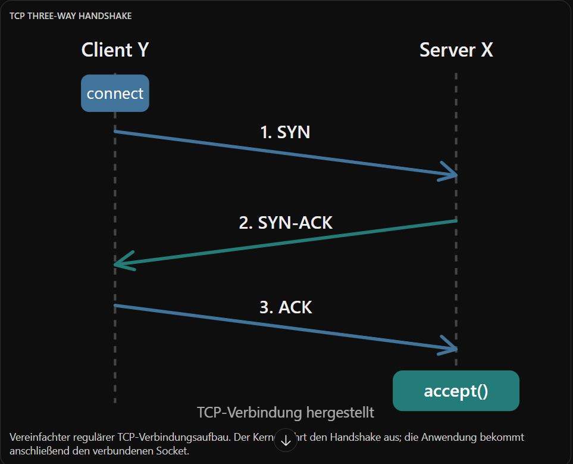
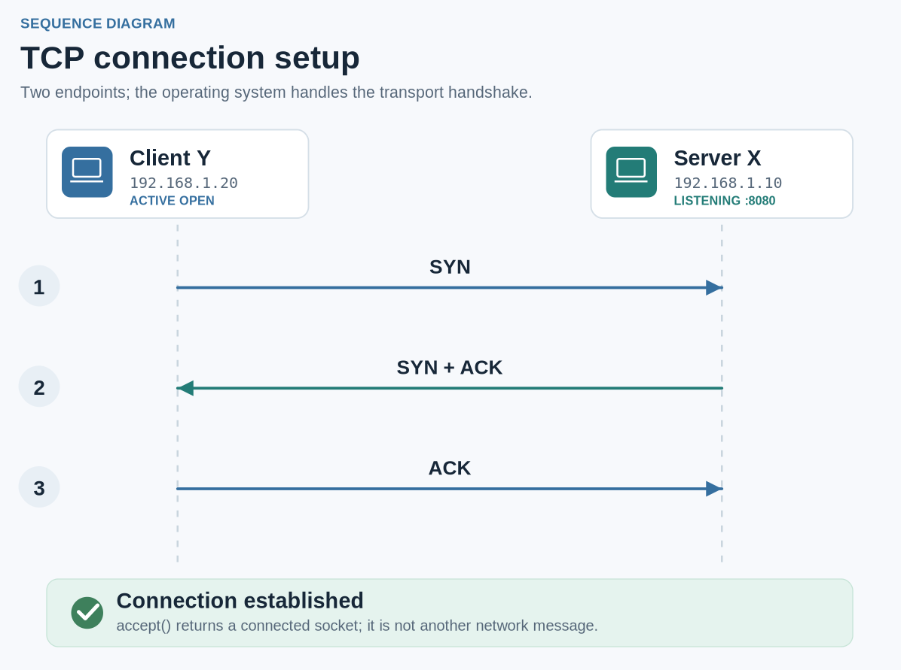

# User reference vs failed previous output

Use these actual cropped visual examples of the **same** diagram. Images are comparisons, not source-of-truth network protocol documents.

**Desired screenshot crop from conversation:** `assets/reference-handshake-crop.png`

**Previous skill output — anti-pattern:** `assets/anti-pattern-handshake.png`

## The key difference

- Reference: arrows and their directions/time order are dominant; two actors, three large labels and two API chips make the relationship recognizable without reading a paragraph.
- Old output: fixed paper background, article-style title/subtitle, container cards with redundant metadata, numbered badges outside the main exchange, and a long bottom success callout all compete with the arrows.
- Fix: tight artboard, transparent canvas, no embedded article heading/caption, only actor names, three message names, and two small endpoint chips. Let prose outside explain TCP reliability, OS ownership, and exceptions.
- The reference screenshot includes chat surface framing and prose outside the illustration. **Do not bake the chat frame, dark background or surrounding prose into the SVG.** An editable exported SVG cannot automatically reproduce native ChatGPT layout behavior merely by being an SVG file.

## Additional reference principles

- In the entropy screenshot, the only important image is eight adjacent position boxes in two states: one selected position, then eight possibilities. Typography communicates '1 vs 8' but does not replace this visual contrast.
- In packet encapsulation, colored segment widths, stacking and nesting explain encapsulation; labels name headers but a verbose paragraph sits outside the graphic.
- In endpoint communication, two object icons and bidirectional arrows carry the story. Ports/IP are identifiers, not card descriptions.

## Five-second test

View the graphic at its actual insertion width. Before reading surrounding paragraphs, can a reader answer *what moved, where, in what order, or what changed?* If the answer requires reading more than a couple of sentences inside the SVG, the SVG is overloaded. Delete, split, or move words outside.
