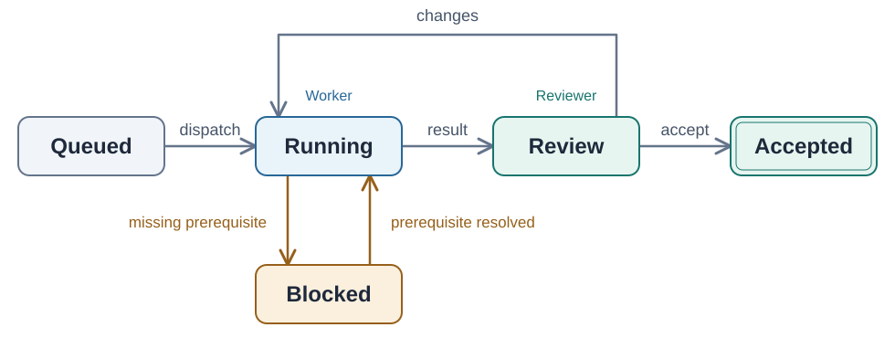

# Engineering Documentation

Help a person understand the software and an agent make a correct, bounded change.
README, agent instructions and deeper documentation answer different questions
about the same system. Give each fact one owner; connect the entrypoints instead
of copying the book into all three.

Code and docs teach different parts of the same design. Detailed local intent,
construction choices and failure reasons belong beside the implementing code.
Docs explain the overall architecture, name applied patterns with their sources
and locations, define cross-module contracts, and show how to use and operate the
system. Link to local reasoning instead of rewriting it into a parallel manual.
Accepted design knowledge must survive the originating chat or review round.

Engineering workflows may load this method directly for affected explanations,
passing their existing evidence; no separate writing request or Good Writing round
is required. Good Writing remains the default router for general writing tasks.
Return to the active caller after the scoped update; preserve native invocation
policy rather than treating workflow composition as automatic catalog selection.

**Let the figure carry the explanation.** For relationships and behavior, start
with a visual explanation and replace the paragraphs it makes unnecessary.
Keep prose for reasons, conditions and consequences the figure cannot convey.
Keep commands, identifiers and exact contracts as text. Every sentence must earn
its place; brevity must preserve meaning, not turn prose into cryptic fragments.

## Example: explain a turn instead of narrating it

Fictional brief: explain an agent harness's turn lifecycle. The verified model
has a worker, a reviewer, a revision loop and a blocked state. A state diagram
answers this question more directly than several paragraphs:

<picture>
  <source media="(prefers-color-scheme: dark)" srcset="assets/turn-lifecycle.dark.svg">
  
</picture>

**Text equivalent:** Queued → Running on dispatch → Review on result → Accepted
on acceptance. Review returns to Running for changes. Running enters Blocked
when a prerequisite is missing; it returns to Running when that prerequisite is
resolved. The worker owns Running; the reviewer owns Review.

**Invariant:** a produced result is not yet an accepted result. Blocked work
resumes only after its recorded prerequisite is satisfied.
Fictional source anchors: `runtime/turns/state.py` and `runtime/review/handler.py`.

The figure replaces the walkthrough. The compact equivalent preserves its
information for readers and tools that cannot see the image; the invariant and
source anchors add what the geometry cannot establish. A separate sequence
diagram would answer *who sends which message when*; do not force both questions
into one overloaded figure. This example is a teaching model, not a claim about
the current repository or a guarantee about interrupted external effects.

The same chapter should make the implemented pattern discoverable: name the
**state machine**, identify the transition-policy owner, and link the inspected
primary source that informed the choice. Keep the reason for a particular guard
beside that guard. A pattern map routes a reader to both kinds of explanation;
the picture alone does not preserve the design decision or its provenance.

## 1. Establish the source and the reader's job

Read the applicable repository instructions, existing documentation map and
affected implementation, public contracts, configuration, tests and runnable
entrypoints. Scope inspection to the requested change. Preserve a working book
and explicit local exceptions; this method does not require a new docs directory.

Reuse a source handoff from Good Writing or Writing Fragments when supplied.
Otherwise use Writing Fragments, if available, for bounded source selection.
For a large system, use Puppeteer, if available, to scout coherent capabilities
and return exact source anchors, stale explanations and proposed figures.
Without those methods, gather the same bounded evidence directly. Do not route
back to Good Writing or restart an active caller.

Distinguish the implemented behavior, intended contract and planned work. Resolve
contradictions at their owner: do not document a bug as a design decision or promise
an unimplemented guarantee. Missing source access remains a verification limit.
SDK docs owned with the implementation belong here even when aimed at external
developers; lack of access does not turn them into a verified standalone manual.

Use Domain Modeling, if available, to resolve ambiguous names, roles and lifecycle
concepts. Use Vertical Slices, if available, to trace capability ownership, public
boundaries and dependencies. Preserve the repository's actual vocabulary and
architecture; a documentation task does not authorize redesigning them. Without
these methods, verify the same relevant distinctions at their existing owners.

## 2. Give each surface a clear responsibility

| Surface | Reader's question and canonical responsibility |
|---|---|
| README | What is this, why is it useful, how does it fit, and how can I use or develop it? Give a compelling concrete entry, a fast start and precise routes to deeper material. |
| Repository AGENTS.md or supported native equivalent | How should an agent work safely and verify changes here? Keep repository-specific commands, non-obvious constraints and task-conditioned pointers. |
| Docs book / developer or SDK documentation | How does the system fit together, which patterns and external contracts shape it, where are they implemented, and how do I use or operate it? Own system-level explanations and procedures; route exact contracts and local design reasons to their existing owners. |
| Source commentary | What role does this unit play in the wider system, why was this construction chosen, and what must a future change preserve? Use Golden Comments, if available, for local models, decisions, invariants and failure consequences. |
| Workboard, plans, issues, PRs and changelog | What is proposed, in progress, blocked or shipped? Keep transient coordination and historical changes here. |

README and docs serve both people and agents. Agent instructions are an operating
entrypoint, not another architecture chapter. Product/domain contracts remain
with their existing owner; indexes and diagrams point to them. No dated progress
notes, agent diaries or “since the last update” appendices belong in maintained
explanations. Rewrite a newly learned durable fact at its owner instead.

## 3. Make the README an inviting, usable entrance

Open with a concrete answer to *what this does and why someone would use it*.
An example result or small overview figure is often more inviting than a feature
inventory. Show how the main parts fit when that helps a newcomer orient.
Avoid slogans, generic badges and an essay before the first useful action.

Provide a compact architectural orientation for a substantive software system.
Keep its overview figure in the README when it explains the whole without
overwhelming the fast start. If it needs several views, detailed contracts or
extended rationale, put that depth in an architecture chapter and give the README
a clear entry. Do not maintain the same overview independently in both places.

Cover each applicable question, with a short verified command/example or a
specific link when the procedure is substantial:

| Question | Useful entry |
|---|---|
| How do I integrate it? | Minimal supported import, API call or binding; prerequisites and expected result. |
| How do I build it? | Actual toolchain/version constraints and build entrypoint. |
| How do I test it? | Supported local check, what it covers and where broader checks live. |
| How do I start or try it? | Smallest real runnable path, required configuration and observable success. |
| How is it deployed? | Deployment owner and verified release path, or a precise operations chapter. |
| Where do I go next? | The documentation map, contribution instructions and relevant support/location. |

Scale to the repository. A library may have an integration example rather than a
server to start; a package may be published rather than deployed. Do not invent
production infrastructure, commands, features or empty sections to fill a template.
If deployment lives in another repository, link its verified owner.

Keep the first successful use close to the top. Move long configuration matrices,
platform variants and operational procedures into focused chapters, preserving
clear entry links in the README. A link called “documentation” is not a substitute
for telling a reader where to find build, test or deployment instructions.

## 4. Make agent instructions small and useful

Inspect the actual client's supported instruction filename, discovery, scope and
precedence before changing agent instructions. A file's presence does not establish
that a client loads it. Preserve local overrides and one canonical instruction
owner; do not invent parallel AGENTS.md/CLAUDE.md copies with drifting rules.
Repository documentation work does not authorize changing global profiles or
client settings. Use State of the Art, if available, for a consequential unresolved
host question; verify against current installed behavior or official documentation.

Keep only information that changes how an agent should work here:

- Necessary environment setup and the correct working directory or command owner.
- Narrow verification commands and the condition requiring broader checks.
- Non-obvious repository constraints, generated-file owners and dangerous shortcuts.
- Task-conditioned entrypoints: what to read for a change to a particular capability.
- Maintenance obligations: which explanation, schema or generated output changes
  with which behavior, and how to verify the result.

For example, in a fictional repository:

```text
For turn-state changes, inspect runtime/turns/state.py and
docs/02-turns/01-lifecycle.md. Run make test-turns; use make test
when changing shared event contracts.
Generated clients come from schema/events.json. Regenerate them with
make clients; do not patch generated files directly.
```

Verify these commands and paths in the real repository before writing them.
Prefer a focused pointer to a second copy of the instructions. Do not add persona,
generic engineering advice, a directory inventory recoverable from code, or a
mandatory tour through every chapter. Add scoped instructions only where the host
supports them and the subtree has genuinely different rules. A small task must
not inherit the reading cost of understanding the entire system.

“Current” means accurate instructions, not an undated status report or fashionable
practice list. Verify changed commands and rules; keep release readiness and open
work at their existing owners. More context is not proven to improve agent results.

## 5. Build an ordered book when the system needs one

A substantial system with several independently useful explanations should have
a navigable book. Keep the established map filename, such as `docs/README.md` or
`docs/00-README.md`, and one canonical map. Organize from orientation and vocabulary
through relationships to capabilities and operations. Number chapters to expose
that teaching order; also provide direct task-based links for reference use.
Reading order is not an instruction for every agent to read every chapter.

Illustrative structure for a system that warrants these subjects:

```text
README.md
AGENTS.md
docs/
  00-README.md                 # map and reader/task paths
  01-architecture.md           # when this depth exceeds the README overview
  02-turns/
    README.md                  # shared contract and chapter routes
    01-lifecycle.md
    02-review.md
    assets/turn-lifecycle.svg
  03-agent-roles/
    README.md                  # collaboration and shared role contract
    01-coordinator.md
    02-worker.md
    03-reviewer.md
    assets/reviewer-turn.svg
  04-operations/
    README.md
    01-configuration.md
    02-deployment.md
    03-recovery.md
```

Use a folder when a substantial subject has several useful parts; keep related
parts together and the hierarchy shallow. A small subject needs one chapter,
not a directory. Do not mirror every code file into docs. Capabilities, modules,
contracts and reader questions earn chapters when their explanation is useful.
Keep numbering and anchors stable; do not renumber the book for every addition.
Repair inbound links when an authorized restructuring changes paths.

The architecture overview explains the actual system at its useful level of
detail. A data-processing application may need a pipeline of inputs,
transformations and outputs. An event-driven system may need producers, a broker
and consumers with meaningful event directions and boundaries. A layered system
may need containment and permitted dependency directions. Draw only components
that exist; distinguish structural dependencies from runtime message flow.
Use UML or another established notation when it improves precision, preserving
its semantics. SVG is the delivery format, not a reason to invent a new notation
or force every architecture into the same boxes and arrows.

Each chapter opens with its question and scope, then explains relationships,
system-level reasons, contracts and verified implementation anchors. State an
invariant and its consequence where a reader needs that contract; link to the
mechanism for enforcement and detailed local rationale. Keep local rules with
their capability instead of copying them into a global catalogue. Source commentary
can be the canonical owner of a construction decision; it is not merely a shorter
copy of a docs chapter. Keep shared vocabulary and configuration definitions at
their existing owners.

Name the architectural and software patterns actually applied, including ones
reused in ordinary feature work. For a substantial system, maintain a compact
applied-pattern map at the existing architecture owner, with primary sources and
precise implementation locations. For example, in a fictional integration:

| Pattern and source | Where to look | Architectural reason |
|---|---|---|
| Gateway — [Fowler](https://martinfowler.com/eaaCatalog/gateway.html) | `providers/catalog.py:CatalogGateway` | External API shapes stop at this boundary; its briefing owns mapping and failure-policy reasons. |
| Composition Root — [Seemann](https://blog.ploeh.dk/2011/07/28/CompositionRoot/) | `app.py:create_app` | Application dependencies are assembled at the entrypoint; consumers receive their dependencies. |

Verify those mappings in the actual repository. A map is navigation, not a second
catalogue of all decisions. Link its entries to the owning source/chapter for
detail. Keep a small repository's few entries in its README. Update the map when
an implemented pattern is added, moved or retired. Do not count rows as quality.

Explain how the pattern fits and where the implementation departs from it. For the
fictional turn model, a state machine makes permitted transitions and review loops
explicit; a fixed linear pipeline would hide the revision and blocked branches.
An enum alone does not establish the transition mechanism. Distinguish recognized
patterns, protocols and project-local terms; label an analogy as an analogy.
Code written locally can still implement an established pattern. Do not replace
recognizable pattern names with generic mechanism labels to avoid the source map.
If the implementation evidence is incomplete, identify the candidate and its exact
unverified relationship. A reference added now supports a definition; it is not
evidence that the original author used that source.

Keep researched evidence with the accepted claim in Markdown, not only in chat.
Cite the actual paper, original pattern description, specification section,
maintainer documentation or first-person engineering account, what was adopted
and which constraints differ. Name the source and provide a usable direct link;
a company's name or a general documentation homepage is not sufficient evidence.
For a protocol such as MCP, identify the implemented version and relevant section,
then the implementation owner. Separate the standard's requirement from local
policy and from conformance checks actually performed.
Use State of the Art, if available, to verify a material claim about current
practice or an external precedent; record the relevant date/version and limits.
Use Engineering Practices, if available, for an unresolved design trade-off;
documentation records the accepted decision rather than inventing a new one.
Keep settled rationale with its chapter or existing decision owner, not duplicated
in every role page or in a second pattern catalogue. Do not add research citations
to every page or call an unverified choice “state of the art.”

Use the Diátaxis distinction between learning, doing, understanding and lookup to
separate different reading jobs. A how-to needs prerequisites, ordered actions and
verification; an API reference needs exact fields and behavior, not an architecture
essay. A chapter can route to related jobs without mixing them into one narrative.
A small repository may need only a README and short agent instructions. Respect
explicit local exceptions, including a repository that forbids creating a docs book.

The role group illustrates a substantial subject that earns separate pages. Its
overview explains collaboration once; each role page owns its purpose, inputs,
tools and permissions, turn behavior, outputs, boundaries and failure modes.
Explain its lifecycle or handoffs with the appropriate figure and only the prose
the figure cannot carry. Keep shared behavior at the group owner; role pages
describe meaningful differences. A deeper role folder is justified by several
independent explanations or assets, not by a desire for symmetry. These are
runtime/domain roles, not copies of coding-agent operating instructions.

## 6. Replace prose with verified visual explanations

Use Editorial SVG Diagrams, if available, for architecture, dependency, lifecycle,
state, sequence and branching explanations. Give it the reader's question, verified
entities/relations, essential conditions and intended embedding size. It owns SVG
construction, light/dark variants, exports and visual checks; do not duplicate its
design manual. If unavailable, keep a faithful available representation and state
the missing method; a required figure remains an open deliverable.

Choose the visual form that makes the answer visible: state for transitions,
sequence for messages over time, containment for ownership, topology for dependencies.
Use the necessary level of detail. Split distinct questions instead of drawing the
entire system at once. Exact parameter comparisons may be clearer as a table;
literal commands remain code. Do not turn prose into tiny text inside SVG boxes.

After drawing, remove the paragraphs that only narrate the same picture. Retain
only additional reasons, preconditions, exceptions and consequences. Give the
figure a short identification and a complete, compact text equivalent of essential
information, adjacent or directly linked. A transition list or small table can
serve this purpose; a second essay cannot. Keep exact identifiers and searchable
source links outside the image. SVG metadata alone is not a proven retrieval or
accessibility channel in every viewer.

Keep editable SVG source and required exports with the owning explanation. During
an authorized revision, modernize legacy figures in scope while preserving their
meaning and required tooling. Verify the replacement before retiring its old
asset. Do not sweep unrelated diagrams. The figure and text describe one model;
update and check them together when that model changes.

## 7. Verify the reading paths and maintain the result

Apply Unslop, if available, to the assembled result: headings, captions, alternatives
and surrounding prose as well as the body. Cut redundancy hard. Do not use a fixed
pass count or percentage reduction. Without it, perform the same meaning-preserving
clarity check directly without claiming the method was loaded.

- Follow the README as a newcomer: can the supported first use succeed, and can
  the reader find integration, build, test and deployment guidance where applicable?
- Follow the agent entrypoint on a representative bounded change: can it find the
  correct owner, relevant instructions and checks without loading the whole book?
  Follow one applied-pattern entry into code and one local briefing back to its
  wider context. Verify that reasons needed for the change survive without chat
  history and that source and docs do not maintain duplicate detailed accounts.
  Label a desk walkthrough separately from an actual agent trial; do not claim
  measured effectiveness from a tidy file tree or subagent agreement.
- Check facts, commands, links and diagram transitions against their owners. Run
  safe examples in the supported environment; do not deploy or mutate production
  just to verify documentation without the corresponding authorization.
- Inspect rendered pages and figures at actual reading width, including relevant
  themes. Check legibility, clipping, arrow direction and the text equivalent.
- Update affected explanations with accepted implementation changes. Preserve
  blocked verification explicitly; a good-looking diagram does not establish a
  system guarantee. Retire obsolete pages/assets and repair callers in the same work.

When consolidating a sprawling book, organize around reader questions and actual
owners. Merge repeated explanations, move detailed construction reasons to the
implementing source when appropriate, and retain a clear route to them. Preserve
patterns, primary-source links, operating instructions and meaningful diagrams.
A smaller file count alone is not an improvement, and no chapter needs to mirror
every source file.

When Road to Glory is the caller, return this result to its documentation phase;
do not restart planning. Use Engineering Review, if available, for independent
acceptance, or request a bounded native review. Author checks are not independent
approval. Record the changed owners and actual checks at the task's existing owner,
not as a diary appended to the README.

Read [NOTICE.md](NOTICE.md) when maintaining this method or checking its lineage
and evidence limits; normal use does not require a research tour.
